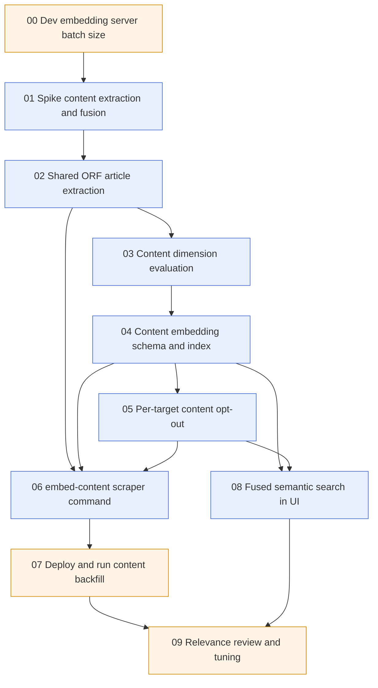

# Epic 0002: Article content embeddings

**Status:** In progress
**Created:** 2026-10-03

## Summary
Semantic search currently embeds only the RSS title of each story. Titles are short, so stories whose topic shows up only in the article body are hard to find. This epic adds a second vector per story, computed from the **article content** fetched from orf.at, backfilled slowly in the background and kept current for new stories. At query time, title and content results are merged with rank fusion. The existing title search and its tuned thresholds stay exactly as they are and remain the fallback.

## Goals
- Every story whose orf.at page still resolves gets a `contentEmbedding`, newest first, at a slow and configurable fetch rate.
- New stories get a content embedding (or a terminal `contentStatus`) within 10 minutes of being scraped, as long as the content job is running.
- `contentEmbedding` lives in the existing vector search index `news_title_vector` next to `titleEmbedding`.
- The content vector dimension (256, 512 or 768) is chosen from an evaluation on real articles, not guessed.
- The Atlas M0 fallback target never receives content embeddings and stays below its 512 MB ceiling.
- Semantic search in the UI uses fused title + content ranking when the serving target has content vectors, and title-only otherwise.
- ORF article text extraction (noise removal, Readability) has a single implementation in `shared`, used by both the UI and the scraper.

## Non-goals
- Storing the raw article text in the database.
- Keyword or full-text search on the article body.
- Chunking or multiple vectors per article.
- Re-embedding titles at more than 256 dimensions.
- Retiring the M0 target.
- Re-embedding content when ORF edits an already embedded article.
- Following read-more links. Teaser pages are embedded as they are, because in the UI the reader decides whether the linked article is loaded.

## Background & context
- **Scraper:** reads RSS feeds only (`scraper/src/services/scraper.ts`, feeds in `scraper/src/sources.ts`). A story is `id, title, category, url, timestamp, source` (`scraper/src/shared/model.ts`). Titles are embedded on insert and on retitle in `scraper/src/services/database.ts` (`persistOrfNews`, `buildStoryUpdate`). The `backfill-embeddings` command (`scraper/src/commands/backfill.ts`) fills gaps newest first.
- **Embedding server:** llama.cpp serving `ggml-org/embeddinggemma-300m-qat-q8_0-GGUF` (`.devcontainer/docker-compose.yml`, port 3003 locally). Its native output is 768 dims and its context is 2048 tokens, but with the default `--ubatch-size 512` llama.cpp rejects inputs over 512 tokens (HTTP 500). Story 00 sets `--batch-size` / `--ubatch-size` to 2048 in the devcontainer, and story 07 does the same in production. Document prompt `title: none | text: <title>` (`scraper/src/shared/search.ts`), query prompt `task: search result | query: <q>` (`ui/src/lib/backend/search/embedding.ts`).
- **Vectors:** Matryoshka-truncated to `TITLE_EMBEDDING_DIMENSIONS = 256`, then int8-quantized by `quantize()` (`shared/src/embedding/embedding.ts`). Index `news_title_vector` has one `vector` path plus `timestamp`, `source` and `category` filters (`db/src/shared/model.ts`). Only the truncated int8 vectors are stored, so titles cannot be moved to higher dimensions without re-embedding them.
- **UI search:** `ui/src/lib/backend/search/semantic.ts` runs one `$vectorSearch`, applies `SEMANTIC_SEARCH_MIN_SCORE = 0.79` and a recency boost (`ui/src/lib/configs/server.ts`). `normalizeQuery` was tuned against title vectors.
- **UI content pipeline:** `ui/src/lib/backend/content/news.ts` fetches an orf.at page and runs jsdom, cleanup (`transform/cleanup.ts`), read-more detection (`transform/anchor.ts`), chart handling (`transform/chart.ts`), Readability (`transform/readability.ts`) and then several presentation-only transforms. It is covered by `news.spec.ts`.
- **`shared` module:** the `orfarchiv-shared` repo is a nested submodule in each consumer (`ui/src/lib/shared/common`, `scraper/src/shared/common`, `db/src/shared/common`), imported as source via `$common/*` / `#common/*`. Bare imports resolve against the consumer's `node_modules`, which is how `mongodb` is used today.
- **Effect versions:** ui, db, scraper and shared use the stable `effect@4.0.2` since story 02 (before: ui and db on `4.0.0-rc.118`, scraper on `rc.117`). HTTP, CLI and persistence live under `effect/*`, no longer `effect/unstable/*`.
- **`$rankFusion`:** available on `mongodb-atlas-local:8.3.3` (tested 2026-10-11 on a scratch DB). Sub-pipelines only allow stages that retrieve, limit or order documents, so score floors are applied after fusion on the per-list raw scores from `scoreDetails` (story 08). M0 only ever runs title-only search.
- **Backups:** `db backup` streams documents via `streamAllNews()` (`db/src/services/database.ts`), which excludes embeddings and `contentStatus: 'embedded'` (story 04). After a restore, `backfill-embeddings` and `embed-content` rebuild them.
- **Infrastructure (epic 0001):** about 437k stories. The primary target is a VPS (`db1.orfarchiv.news:27017`, `mongodb-atlas-local:8.3.3`, 4 vCPU / 8 GB / 80 GB). The fallback is Atlas M0 with a 512 MB ceiling and is already close to full. Targets come from `ORFARCHIV_DB_URLS` (`shared/src/targets/targets.ts`) and are labelled by URL authority. `db setup`, `sync` and `verify` treat all targets as identical.

## Proposed approach
1. **Separate field, same index.** Add `contentEmbedding` as a second `vector` path in `news_title_vector`, with its own `numDimensions` (`CONTENT_EMBEDDING_DIMENSIONS`). `titleEmbedding` is untouched. The index name `news_title_vector` is historical: it covers both paths, and renaming it would force another drop and recreate.
   - *Alternative considered:* one combined `title: <title> | text: <body>` vector replacing `titleEmbedding`. Rejected because it invalidates `MIN_SCORE` and the query-casing findings, and because during a multi-day backfill it would mix title-only and title+content vectors in one field with scores that can't be compared.
2. **Shared, Effect-based extraction.** The presentation-independent part of the UI pipeline moves to `shared/src/storyContent/storyContent.ts` as an Effect service (`StoryContentService`), including DOM creation with jsdom (a peer dependency), so the UI and the scraper parse pages identically. HTTP fetching stays per consumer. The UI delegates to it, so the embedded text is the article body readers see, without UI additions such as chart labels, slideshows and the footer.
3. **Slow content job.** A new scraper command, `embed-content`, picks stories without a `contentStatus`, newest first, via the `content_status_timestamp` index. For each one it fetches the page at a slow rate, extracts the text, embeds `title: <title> | text: <body>` truncated to fit the context window, and writes the vector to all non-excluded targets. Processed stories get `contentStatus: 'embedded'`, and unfetchable or empty pages get `'failed'`, so they aren't retried forever. It runs as its own long-lived container with `--poll`, processing batches back to back (paced by the fetch rate limiter and the embedding server) and waiting only when the backlog is empty, decoupled from `scrape`.
4. **Embedding only.** No article text is stored. A later model or dimension change means fetching the pages again, which is accepted.
5. **Per-target opt-out.** `ORFARCHIV_CONTENT_EMBEDDING_EXCLUDED_TARGETS` lists target labels, for example the M0 label.
   - The scraper never writes content to those targets.
   - `db setup` creates their index without the content path.
   - `db sync` and `db verify` skip content there.
   - The UI uses title-only search when it reads from such a target.
6. **Fused search.** Embed the query once at full dimensions and truncate it to 256 for the title path and to `CONTENT_EMBEDDING_DIMENSIONS` for the content path. Combine both `$vectorSearch` pipelines with `$rankFusion`, and apply the score floors after fusion via `scoreDetails`. Keep the filters and the recency boost. Put the feature behind `ORFARCHIV_SEMANTIC_CONTENT_ENABLED`.
7. **Evaluation in two steps.** An automated known-item evaluation picks the content dimension (story 03). A manual side-by-side review tunes the fused ranking before it is enabled (story 09).

## Stories
| # | Story | Owner | Depends on | Estimate | Status |
|---|-------|-------|------------|----------|--------|
| 00 | [Dev embedding server batch size](00-dev-embedding-batch-size.md) | Human | – | S | Done |
| 01 | [Spike: content extraction and fusion](01-spike-content-extraction.md) | Claude | 00 | M | Done |
| 02 | [Shared ORF article extraction](02-shared-article-extraction.md) | Claude | 01 | L | Done |
| 03 | [Content dimension evaluation](03-content-dimension-eval.md) | Claude | 02 | M | Done |
| 04 | [Content embedding schema and index](04-content-embedding-schema.md) | Claude | 03 | M | Done |
| 05 | [Per-target content opt-out](05-per-target-content-opt-out.md) | Claude | 04 | M | Todo |
| 06 | [embed-content scraper command](06-embed-content-command.md) | Claude | 02, 04, 05 | L | Todo |
| 07 | [Deploy and run content backfill](07-deploy-content-backfill.md) | Human | 06 | M | Todo |
| 08 | [Fused semantic search in UI](08-fused-semantic-search.md) | Claude | 04, 05 | L | Todo |
| 09 | [Relevance review and tuning](09-relevance-review-tuning.md) | Human | 07, 08 | M | Todo |

Estimates: S ≈ half a day or less, M ≈ 1 day, L ≈ 2 days. Total ≈ 12–13 days of hands-on work. The backfill in story 07 additionally runs in the background for days.

## Story order

Stories 06–07 (content job) and 08 (UI) can be worked on in parallel once 05 is done.

## Risks & open questions
- **orf.at fetch rate and terms.** The rate is confirmed: 10 pages/s (up to ≈ 864k pages/day, so fetching alone would cover the archive in ≈ 12 hours). In practice the CPU-capped embedding server is the bottleneck: at the ≥ 25 docs/min calibration minimum the backfill takes up to ≈ 12 days, and less if the server is faster. If orf.at answers with 429 or 403, lower the rate (story 07 troubleshooting). The User-Agent string is decided by the user during story 06. `orf.at/robots.txt` does not exist, so there are no published crawl rules to follow.
- **Old page markup.** Resolved by story 01: 0 empty extractions in 297 pages from 2022–2026, and markup differs by site (two families), not by year. Seven extra text-only selectors remove the remaining dates, credits and labels.
- **Embedding throughput.** Long inputs on a CPU-only llama.cpp server are much slower than titles. Story 01 measures tokens/s. If embedding, not fetching, is the bottleneck, the backfill rate is set by the embedding server, and the title embeddings of live scrapes and search queries must not be starved. The separate CPU-capped embedding instance for the content job (story 07) handles this.
- **CPU contention on the VPS.** The production embedding server runs on the VPS, so its 4 vCPU are shared by mongod, mongot, the embedding server and both scraper containers. The UI on Vercel calls the same embedding server for every semantic query, so a busy backfill directly slows search. Mitigation: run a **second, CPU-capped llama.cpp instance** just for the content job (for example `cpus: 1.5`, `--threads 1`) and point only `scraper-content` at it. This needs no code change, because each container has its own `ORFARCHIV_EMBEDDING_URL`. Story 07 sets it up and calibrates the cap on the VPS.
- **Search index rebuild means downtime.** Adding a path to `news_title_vector` needs a drop and recreate, because atlas-local rejects `updateSearchIndex` for vector indexes (epic 0001 story 03, re-tested 2026-10-06, see story 04). Semantic search on the VPS is down until 437k vectors are re-indexed. Story 01 measures the duration, story 04 adds `setup --wait-until-queryable`, and story 07 schedules the outage. Story 01 measured 18 s locally for the full collection with title vectors (36 s with a content vector on every story); on the 4 vCPU VPS expect minutes, well below the threshold. If the rebuild takes longer than ~15 minutes: build the new definition under a second index name, switch the UI over, then drop the old one (needs a coordinated UI release and briefly doubles mongot memory for the title vectors).
- **mongot RAM.** At 768 dims, the content vectors alone are ≈ 335 MB plus the HNSW graph. That fits the 8 GB VPS, but story 03 reports it so the choice is explicit.
- **Partial coverage.** While the backfill runs, fused ranking favours stories that already have content. Story 09 checks whether fusion should be enabled only after the backfill is complete.

## Assumptions
- Story URLs across the whole archive still resolve on orf.at (stated by the user; story 01 verifies on a sample).
- The text that matters for retrieval fits into the first ~1024 tokens of an article, because news front-loads the important information. Story 01 confirmed it: 85% of articles fit completely.
- The content vector dimension is `CONTENT_EMBEDDING_DIMENSIONS = 512` (decided by the user on 2026-10-11 after story 03: paraphrase recall@10 90.3 % vs 91.9 % at 768 and 82.7 % at 256, ≈ 280 MB of mongot RAM for 437k stories).
- Content inputs are truncated to `CONTENT_MAX_TOKENS = 1024` tokens (decided by the user on 2026-10-11 after story 01).
- There is no minimum text length: any non-empty extracted text is embedded, including short teasers (decided by the user on 2026-10-11 after story 01). Only unavailable pages and empty extractions get `failed`.
- A one-time full re-fetch of orf.at is acceptable if the model or dimension ever changes, since no text is stored.
- The orf.at fetch rate is 10 pages/s (confirmed by the user on 2026-10-10; it replaces 1 page every 2 s from 2026-10-03).
- The content dimension is chosen on retrieval quality only; cost is reported but not a criterion (confirmed by the user on 2026-10-09).
- Calibration targets for the content job on the VPS: query-embedding p95 below 1 s on the main instance while the job runs, and ≥ 25 docs/min for the job (story 07, step 12).
- The M0 target label is `<cluster>.mongodb.net`, as in epic 0001.

## Definition of done
- All stories are Done. Lint and tests are green in `shared`, `scraper`, `db` and `ui`.
- On the VPS, `embedded + failed ≥ 99%` of all stories (story 07 verify query) and `failed < 10%`, unless story 01 documented a different expectation. On M0, `countDocuments({ contentEmbedding: { $exists: true } }) = 0`, and `db verify` exits 0.
- The `embed-content` container runs in poll mode on the VPS. Its newest-first backlog is empty because every story has a `contentStatus`.
- Fused semantic search is enabled in production after the story 09 review, and the README sections in `scraper`, `db` and `ui` describe the new command and env variables.
