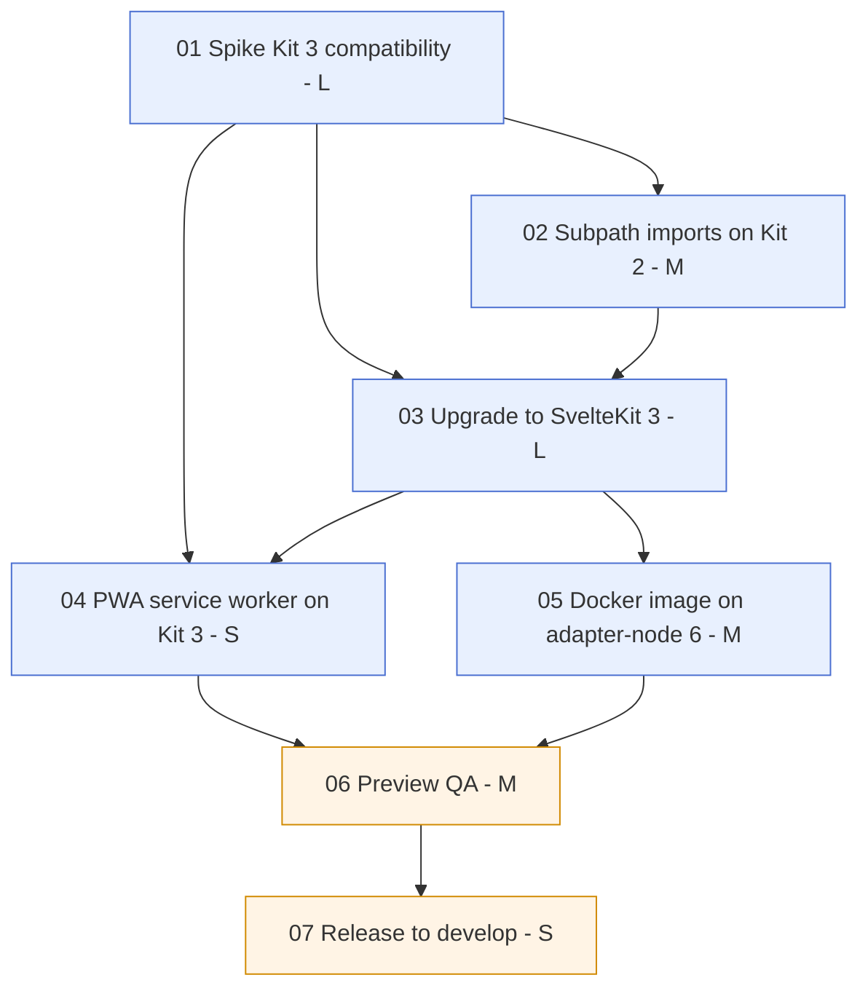

# Epic 0003: SvelteKit 3 migration

**Status:** In progress
**Created:** 2026-10-19

## Summary

SvelteKit 3 is stable (`@sveltejs/kit@3.1.0` is `latest` on npm, published alongside `@sveltejs/adapter-node@6.0.0` and `@sveltejs/adapter-vercel@7.0.1`). The `ui` submodule runs on `@sveltejs/kit@2.70.3`, the last 2.x release. This epic moves `ui` to SvelteKit 3 without changing user-facing behaviour. It covers the dependency bump, the breaking changes that affect this codebase, the PWA/service-worker setup, the Docker image, and a QA'd release to `develop`. Staying on 2.x would block future Kit features (remote functions, the new error handling and service worker tooling) and, eventually, security fixes.

Sources: [SvelteKit 3 is here](https://svelte.dev/blog/sveltekit-3-is-here), [Migrating to SvelteKit 3](https://svelte.dev/docs/kit/migrating-to-sveltekit-3).

## Goals

- `ui` pins `@sveltejs/kit` 3.1.x, `@sveltejs/adapter-vercel` 7.x and `@sveltejs/adapter-node` 6.x (exact versions, as in the rest of `package.json`).
- `npm run lint`, `npm run check`, `npm run test:unit`, `npm run test:e2e`, `npm run build` and `npm run storybook:build` pass in `ui`, and the CI workflows (`ci.yaml`, `test.yaml`, `storybook.yaml`) are green.
- No `$lib` imports remain. `#lib/*` and `#common/*` are package.json subpath imports. Both use explicit file extensions in the import specifiers. For `#common` this deliberately differs from `scraper` and `db`, which map `#common/*` to `*.ts` and import without an extension.
- Storybook builds, every story renders, and the GitHub Pages deployment from `develop` still works.
- The PWA still works: service worker installs, precaches, serves the API fallbacks offline, shows the update prompt and handles notification clicks.
- The Docker image (`USE_ADAPTER_NODE=true`) builds and serves the app.
- The migration is merged into `ui` `develop` and published as a `5.0.0-next.N` prerelease.

## Non-goals

- Adopting new SvelteKit 3 features that aren't needed for the migration: remote functions, `src/params.ts`, `src/instrumentation.server.ts` / OpenTelemetry tracing, `$app/manifest`.
- Upgrading unrelated dependencies (Storybook, Tailwind, tRPC, Effect…) unless SvelteKit 3 requires it. Moving server runtime packages from `devDependencies` to `dependencies` (story 05) changes no versions.
- Redesigning the service worker caching strategy. Only what's needed to keep current behaviour.
- Changes in `db`, `scraper` or `shared`.
- Releasing to `main`/production. That happens later with a regular release.

## Background & context

**Already SvelteKit-3-ready** (adopted on 2.x previews):

| Requirement | Required | `ui` today |
|---|---|---|
| Node | ≥ 22.17 | `engines.node: 24.x`, `node:24-alpine` |
| TypeScript | ≥ 6 | `6.0.3` |
| Svelte | ≥ 5.57.1 | `5.57.2` |
| Vite | ≥ 8.0.12 | `8.3.4` |
| `@sveltejs/vite-plugin-svelte` | ≥ 7 | `7.3.1` |
| Config in `vite.config.ts` | required | done, no `svelte.config.js` (`ui/vite.config.ts`) |
| `$app/env`, `$app/env/private`, `$app/env/public` | `$env/*` deprecated | done, no `$env/*` imports |
| `defineEnvVars` from `@sveltejs/kit/env` | moved | done (`ui/src/env.ts`) |
| `$app/state` instead of `$app/stores` | required | done |
| `resolve` from `$app/paths` (no `base`/`resolveRoute`) | required | done |
| `compilerOptions.experimental.async` | needed for async `handleError` | already on |

**Affected by breaking changes** (from a grep of `ui/src`, `ui/tests`, `ui/.storybook`):

- **`$lib` alias removed.** ~440 `$lib/...` import statements in ~130 files, plus `tests/specs/news.spec.ts`. About two thirds omit the file extension, which subpath imports require. Custom `alias` entries in `vite.config.ts` and `vite.storybook.config.ts`: `$lib`, `$common` (9 files, the nested `orfarchiv-shared` submodule at `src/lib/shared/common`), `$assets` (unused).
- **tsconfig.** `ui/tsconfig.json` extends `./.svelte-kit/tsconfig.json`. It must extend `$app/tsconfig` with its own `include`/`exclude`, and the service worker needs its own tsconfig extending `$app/tsconfig/service-worker`.
- **Service worker.** `ui/src/service-worker.ts` (single file, Workbox, built by `@vite-pwa/sveltekit@1.1.0` with `strategies: 'injectManifest'`). It imports `json` from `@sveltejs/kit` (deprecated in favour of `Response.json`). Kit 3 now bundles and registers the service worker as a module, and documents `src/service-worker/index.ts`. **`@vite-pwa/sveltekit@1.1.0` declares peer `@sveltejs/kit: ^1.3.1 || ^2.0.1`**, and no Kit 3 support is announced. `AppLayout.svelte` uses `virtual:pwa-info`. `utils/updateListener.ts` and `utils/notifications.ts` use `navigator.serviceWorker`.
- **Server-only modules.** Files with a `server` segment become server-only. `src/lib/configs/server.ts` is imported only from `src/lib/backend/**` (and `import type` of the router from `src/lib/api/*`), so no change is expected, but the build will confirm.
- **Error page.** `src/routes/+error.svelte` calls `error(404, …)` and `redirect(302, '/')` during render. Kit 3 routes rendering errors through `handleError` and error boundaries, so this must be re-verified.
- **Navigation.** `ButtonLink.svelte` calls `preloadData(href)` and ignores the result. It may now resolve to `{ type: 'error' }`. Clicking a link to the current page now calls `refreshAll()` (affects the header title link to `/`).
- **Adapters.** Vercel is production (`adapter-vercel`, Node runtime, not edge). The Docker image uses `adapter-node` (`USE_ADAPTER_NODE=true`). adapter-node 6 bundles with rolldown, drops `ORIGIN` (replaced by `paths.origin`) and serves static assets from a build-time list, GET/HEAD only. The current `ui/Dockerfile` also `COPY`s `svelte.config.js` and `postcss.config.cjs`, which no longer exist, so the image probably doesn't build today.
- **Unaffected:** no cookies, no `handleError`/`handleValidationError`, no `src/params/`, no `$app/forms`, no `pushState`/`replaceState`/`invalidateAll`, no `csrf`/`ORIGIN` config, no `@sveltejs/kit/node`, no `data-sveltekit-*="off"`.
- **Storybook.** `@storybook/sveltekit@10.6.2` with `vite.storybook.config.ts`, 17 stories under `src/stories/**`, built and deployed to GitHub Pages on every push to `develop` (`.github/workflows/storybook.yaml`).
- **Third-party integrations to verify:** `@vite-pwa/sveltekit`, `@storybook/sveltekit@10.6.2`, `sonda/sveltekit`, `svelte-check@4.7.7`, `eslint-plugin-svelte@3.23.1`, Vitest config that spreads `vite.config.ts`.
- **Repo workflow.** `ui` is a submodule. Day-to-day work happens on `develop`, prereleases are cut by semantic-release (`5.0.0-next.20`), `main` is the release branch.

## Proposed approach

1. **De-risk first (story 01).** A throwaway spike installs Kit 3 and the new adapters and runs `npx sv migrate sveltekit-3` on a scratch copy. It records what breaks in the PWA, Storybook and Sonda integrations, and decides how the service worker is built on Kit 3. The spike decides scope; nothing from it is merged.
2. **Do what's possible on Kit 2 (story 02).** Subpath imports (`#lib/*`, `#common/*`) and `Response.json` work on Kit 2 with Vite 8 and TypeScript 6. Landing the biggest mechanical diff in its own commits keeps the actual upgrade diff small and reviewable.
   - _Alternative considered:_ let `sv migrate` rewrite `$lib` during the upgrade. Rejected because it mixes ~130 mechanical file changes with the real breaking changes in one diff. The codemod can still be used in story 02 if it runs on Kit 2. Otherwise a scripted rewrite is used.
3. **Core upgrade (story 03).** Bump Kit and the adapters, run `sv migrate`, fix its TODO list, tsconfig and the error page, and get all checks green. The service worker is kept building but may be temporarily simplified, if the spike says so.
4. **PWA on Kit 3 (story 04).** Decided in story 01 (option A): replace `@vite-pwa/sveltekit@1.1.0`, which builds on Kit 3 but leaves the precache empty, with the fork `@katama-labs/vite-pwa-sveltekit@2.0.0` and `vite-plugin-pwa@2.0.0`. This is a one-line import change that keeps today's PWA behaviour. Kit's native service worker (option B) was prototyped too and is the fallback if the fork breaks.
5. **Docker image (story 05).** Fix the Dockerfile and make adapter-node 6 work.
6. **Human QA on a Vercel preview, then merge into `develop` as a prerelease (stories 06, 07).**

## Stories

| # | Story | Owner | Size | Depends on | Status |
|---|-------|-------|------|------------|--------|
| 01 | [Spike: Kit 3 compatibility](01-spike-kit3-compatibility.md) | Claude | L | – | Done |
| 02 | [Subpath imports on Kit 2](02-subpath-imports.md) | Claude | M | 01 | Todo |
| 03 | [Upgrade to SvelteKit 3](03-upgrade-sveltekit-3.md) | Claude | L | 01, 02 | Todo |
| 04 | [PWA service worker on Kit 3](04-pwa-service-worker.md) | Claude | S | 01, 03 | Todo |
| 05 | [Docker image on adapter-node 6](05-docker-adapter-node.md) | Claude | M | 03 | Todo |
| 06 | [Preview QA](06-preview-qa.md) | Human | M | 04, 05 | Todo |
| 07 | [Release to develop](07-release-to-develop.md) | Human | S | 06 | Todo |

**Size overview:** 2×S, 3×M, 2×L. Claude: L, M, L, S, M. Human: M, S. Largest remaining risk: **03** (cross-cutting upgrade; story 01 mapped the codemod output and fixes, but error-page behaviour under Kit 3 is unverified). Story 04 shrank from L to S because story 01 found a drop-in Kit 3 build of the PWA plugin.

## Story order

## Risks & open questions

- **`@vite-pwa/sveltekit` and Kit 3 (answered in story 01).** 1.1.0 builds on Kit 3 (with a peer override) but never injects the precache manifest, so the app doesn't work offline. Its Kit 3 PR ([vite-pwa/sveltekit#111](https://github.com/vite-pwa/sveltekit/pull/111)) was closed unmerged, and an official v2 has no date. Decision: use the PR author's fork `@katama-labs/vite-pwa-sveltekit@2.0.0` (story 04).
- **Fork maintenance (new).** The fork has one publisher and one release. If a later Kit 3.x breaks it, fall back to Kit's native service worker (option B, prototyped in story 01). Switch back to the official `@vite-pwa/sveltekit` once v2 supports Kit 3 (follow-up outside this epic).
- **Vercel packages' peer ranges (new, story 03).** `@vercel/analytics@2.0.1` and `@vercel/speed-insights@2.0.0` declare `@sveltejs/kit ^1 || ^2`. Without npm `overrides`, `npm ci` fails with `ERESOLVE`. Remove the overrides once they declare Kit 3 support.
- **Storybook must keep working (answered in story 01).** Dev mode renders all stories on Kit 3 as is. The static build (GitHub Pages) breaks every story with `__SVELTEKIT_PAYLOAD__ is not defined`. Fixed by `define: { __SVELTEKIT_PAYLOAD__: 'undefined' }` in `vite.storybook.config.ts`, which story 03 applies. No package change needed.
- **`.ts` extensions in `#lib` imports (answered in story 01).** `#lib/models/story.ts` / `#common/targets/targets.ts` with `"#lib/*": "./src/lib/*"` works in `check`, `build`, `dev`, Vitest, Playwright and Storybook, on Kit 2.70.3 and on Kit 3.1.0. The codemod emits `.js` and skips `$common`, so story 02 uses a script instead.
- **`experimental.explicitEnvironmentVariables` (answered in story 01).** Removed in Kit 3. Explicit env is the only mode, and the type rejects the key, so `check` fails until story 03 deletes it.
- **`alias` option and `svelte-kit sync` CLI (answered in story 01).** `alias` still works but is deprecated (build warning). `svelte-kit sync` still exists unchanged, so scripts, the Dockerfile and CI keep using it.
- **`+error.svelte` throwing `redirect`/`error` during render.** It may behave differently under Kit 3 error boundaries. Mitigation: explicit acceptance criteria in story 03. If needed, the logic moves to a `src/hooks.server.ts` `handle` → story 03, step 5.
- **Docker image (answered).** It isn't deployed anywhere and is kept as a fallback to Vercel. It looks unbuildable today (missing `svelte.config.js`/`postcss.config.cjs`); story 05 fixes it and moves server runtime packages to `dependencies`.

## Assumptions

- All stories are done on a single branch `feat/sveltekit-3` in the `ui` submodule, branched from `develop`, matching the `feat/<epic>` convention of epic 0002. There are no per-story branches or PRs. The only PR is `feat/sveltekit-3` → `develop` in story 07, so `develop` never sees a half-migrated state. No other submodule changes. The user creates the branch.
- The target is `@sveltejs/kit@3.1.x` (current `latest`), not the `next` tag.
- Vercel creates a preview deployment for `feat/sveltekit-3`. `develop` is deployed to https://develop.orfarchiv.news, where story 07 smoke-tests it. Production (`main`) isn't touched. The Docker image isn't deployed anywhere; it's kept as a fallback and must keep building and running.
- PWA behaviour (offline fallbacks, update prompt, notifications) must stay as it is. The caching strategy itself isn't redesigned.
- `src/lib/shared/common` (the `orfarchiv-shared` submodule) has no `$`-alias imports of its own, so it needs no changes.

## Definition of done

- All stories are Done.
- `ui` `develop` is on SvelteKit 3, released as a `5.0.0-next.N` prerelease. All CI workflows are green.
- The story 06 QA checklist passed on the Vercel preview, and https://develop.orfarchiv.news passed the smoke test.
- No `$lib`, `$common`, `$assets` or `@sveltejs/kit` `json(`/`text(` usages remain in `ui`.
- The root repo's `ui` submodule pointer is bumped to the released commit.
