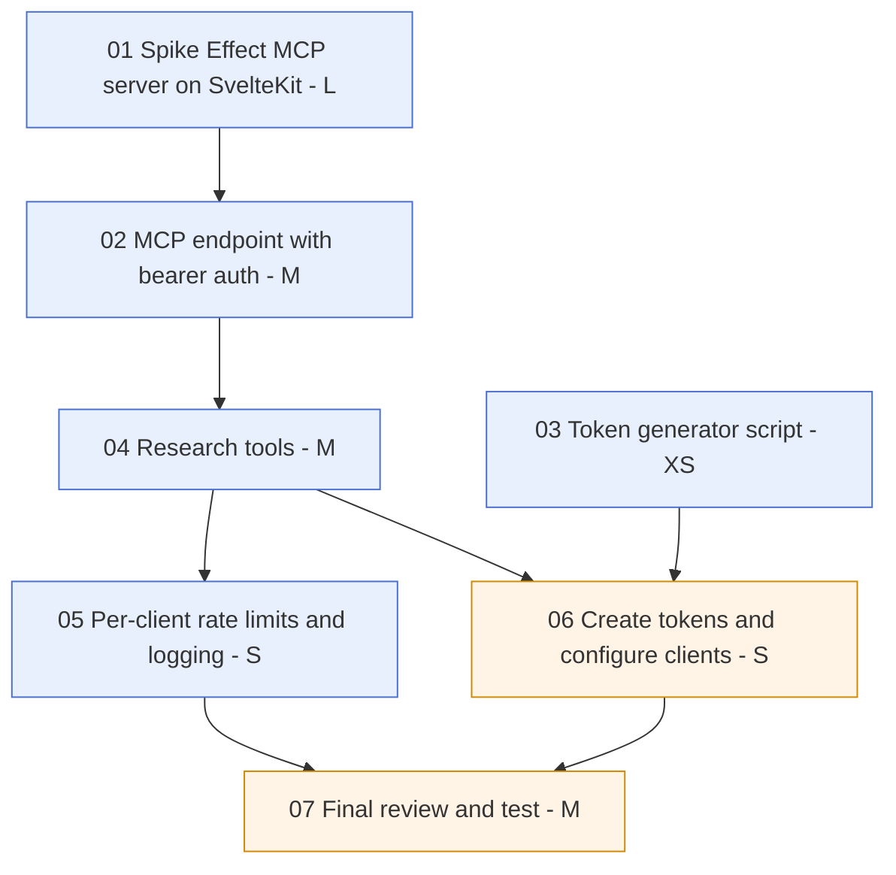

# Epic 0005: Remote MCP server

**Status:** Planned
**Created:** 2026-11-13

## Summary

Expose ORF Archiv's search and content extraction as a remote [MCP](https://modelcontextprotocol.io) server at `https://orfarchiv.news/api/mcp`, so AI agents (Claude Code, Claude Desktop, the Agent SDK, custom scripts) can research ORF news directly: search the archive by keyword or meaning, filter by date and source, and read article text, without a browser. The server lives in the `ui` SvelteKit app next to the tRPC API, reuses the existing backend functions, and is protected by static bearer tokens: one token per client, stored only as SHA-256 hashes on the server.

## Goals

- `POST /api/mcp` on https://develop.orfarchiv.news (production after the next release to `main`) serves the MCP Streamable HTTP transport with three tools: `search_news`, `get_story_content`, `list_sources`.
- Every request needs `Authorization: Bearer <token>`. Missing or unknown tokens get `401` with `WWW-Authenticate: Bearer`, and no tool code runs. If `ORFARCHIV_MCP_TOKENS` is unset, the endpoint is disabled (`404`).
- Tokens are generated with `npm run generate:mcp-token -- <label>`. The server only stores `label:sha256` pairs in `ORFARCHIV_MCP_TOKENS`, and compares them in constant time.
- Tool calls are rate-limited and logged per token label; the plain token never appears in logs.
- Claude Code connects with a token and can run a research task end to end (search → read articles → answer) against https://develop.orfarchiv.news. Production gets the endpoint with the next regular release to `main`, outside this epic.
- `npm run lint`, `npm run check`, `npm run test:unit`, `npm run build` pass, and the Playwright suite (run by `test.yaml` against Vercel deployments) stays green.

## Non-goals

- OAuth 2.1 / MCP authorization flow, and therefore claude.ai custom connectors (web and mobile), which expect OAuth or no auth. Possible follow-up epic; only the auth check in front of `/api/mcp` would change.
- WebMCP (tools in the user's browser tab acting on bookmarks, filters, settings). Planned earlier as this epic, dropped because research agents run outside the browser. Possible follow-up epic.
- Tools that touch user state: bookmarks live in the browser's IndexedDB and aren't reachable from the server.
- A durable, cross-instance rate-limit store (e.g. Redis). The limit uses the existing in-memory store and is per Vercel instance (see risks).
- A token management UI or token expiry. Tokens are managed via the env var and redeploys.
- Changes in `db`, `scraper` or `shared`.

## Background & context

**Backend functions to reuse** (`ui/src/lib/backend`):

| Function | File | Notes |
| --- | --- | --- |
| `searchNews(searchRequest, clientId?)` | `search/news.ts` | Keyword (`anyOf`/`allOf`) or semantic search; `clientId` is the key of the embedding rate limiter; returns `News` with `nextKey`/`prevKey` (`PageKey` = `{ id, timestamp, type }`), page size `NEWS_QUERY_PAGE_LIMIT` = 100 |
| `fetchStoryContent(url, fetchReadMoreContent)` | `content/news.ts` | Returns `Result<StoryContent, …>`; `StoryContent.contentChapters` are plain-text segments, `contentHtml` is HTML |
| `isEmbeddingConfigured()` | `search/embedding.ts` | Whether semantic search is available |
| `RateLimiter` (`effect/persistence`) | `search/embedding.ts` | Token bucket with `layerStoreMemory`, keyed `embeddings:${clientId}` |

Input validation already exists as Effect schemas: `SearchRequest`/`SearchRequestParameters` (`models/searchRequest.ts`), `StoryContentRequest` (`models/storyContentRequest.ts`, URL restricted with `isOrfUrl`, so the content tool can't fetch arbitrary URLs). Sources are the 17 keys in `models/settings.ts`.

**Server and runtime.** The tRPC API is a catch-all SvelteKit route (`src/routes/api/trpc/[...procedure]/+server.ts`). Server env vars are declared in `src/env.ts` with `defineEnvVars` (server-only, read at runtime). Logging uses `logger` from `src/lib/utils/logger.ts`. Production runs on Vercel (serverless functions, Node runtime); the Docker image (adapter-node) is a long-lived fallback.

**Effect has an MCP server.** `effect@4.1.1` ships `effect/ai/McpServer` (marked unstable):

- `McpServer.layerHttpRequestScoped({ path, protocols, registrations, … })` is the transport for serverless hosts: one execution per request, **only sessionless protocols** (`McpProtocol.v2026_07_28`).
- `McpServer.layerHttp(…)` is a long-lived server with sessions (`v2025_11_25`, `v2025_06_18`, …). Sessions live in memory, which breaks when Vercel routes requests of one session to different instances.
- Both reject requests with an `Origin` header not in `allowedOrigins`, and leave authentication to the surrounding router: `HttpRouter.middleware` can provide request-level services (e.g. the authenticated client label) to tools.
- `HttpRouter.toWebHandler(layer)` turns the router into a `(Request) => Promise<Response>` handler for a SvelteKit `+server.ts`.
- Tools are defined with `Tool`/`Toolkit` from `effect/ai` and registered with `McpServer.toolkit(…)`. `effect/ai/McpTest` provides an in-memory client for tests.

Which protocol versions current MCP clients speak (and therefore which transport works) is the main unknown; story 01 answers it.

**Tests.** Vitest unit tests live next to the code (`src/**/*.spec.ts`, Node environment). The Playwright suite runs in CI against the Vercel deployment URL (`.github/workflows/test.yaml`, `TEST_BASE_URL`), without secrets.

## Proposed approach

1. **Spike (story 01).** Verify `McpServer` inside a SvelteKit route on Vercel and adapter-node, and which protocol versions Claude Code, Claude Desktop and the MCP Inspector negotiate. Decide between `layerHttpRequestScoped` (sessionless) and `layerHttp` (sessions), and how the auth middleware hands the client label to tools.
2. **Endpoint with auth (story 02).** `src/routes/api/mcp/+server.ts` delegates `GET`/`POST`/`DELETE` to a web handler built once from `src/lib/backend/mcp/server.ts`. An `HttpRouter` middleware checks the bearer token against `ORFARCHIV_MCP_TOKENS` and provides an `McpClient` service (`{ label }`). No tools yet.
3. **Token script (story 03)** `scripts/generate-mcp-token.js` prints a token and its `label:hash` entry.
4. **Research tools (story 04)** wrap `searchNews`, `fetchStoryContent` and `sources` with compact, agent-friendly output (plain text, opaque page cursor, `maxChars`).
5. **Per-client limits and logging (story 05)** with the existing `RateLimiter`, keyed by token label.
6. **Human: create tokens and configure Vercel and clients (story 06).**
7. **Final review and research test (story 07).**

- _Alternative considered:_ `@modelcontextprotocol/sdk` instead of Effect's `McpServer`. Kept as fallback if story 01 finds Effect's (unstable) implementation unusable; Effect is preferred because the backend and schemas are already Effect, and it adds no dependency.
- _Alternative considered:_ a separate MCP service/repo. Rejected: it would duplicate DB access, search and content extraction, and need its own deployment.

Branching: all Claude stories on `feat/mcp-server` in the `ui` submodule, branched from `develop`. One PR `feat/mcp-server` → `develop` after story 07.

**Token format** (shared by stories 02, 03, 06): token `oa_mcp_` + 32 random bytes base64url. Env var `ORFARCHIV_MCP_TOKENS` = entries `label:sha256hex` separated by `;`. Labels match `[a-z0-9-]{1,32}`.

## Stories

| #   | Story                                                             | Owner  | Size | Depends on | Status |
| --- | ----------------------------------------------------------------- | ------ | ---- | ---------- | ------ |
| 01  | [Spike: Effect MCP server on SvelteKit](01-spike-effect-mcp-server.md) | Claude | L    | –          | Todo   |
| 02  | [MCP endpoint with bearer auth](02-mcp-endpoint-bearer-auth.md)   | Claude | M    | 01         | Todo   |
| 03  | [Token generator script](03-token-generator-script.md)            | Claude | XS   | –          | Todo   |
| 04  | [Research tools](04-research-tools.md)                            | Claude | M    | 02         | Todo   |
| 05  | [Per-client rate limits and logging](05-rate-limits-and-logging.md) | Claude | S    | 04         | Todo   |
| 06  | [Create tokens and configure clients](06-create-tokens.md)        | Human  | S    | 03, 04     | Todo   |
| 07  | [Final review and test](07-final-review-and-test.md)              | Human  | M    | 05, 06     | Todo   |

**Size overview:** 1×XS, 2×S, 3×M, 1×L. Claude: L, M, XS, M, S. Human: S, M. Largest risk: **01** (Effect's MCP server is unstable API, and the sessionless protocol it needs on serverless may not be supported by today's clients).

## Story order

## Risks & open questions

- **Protocol vs. hosting (story 01).** On Vercel, only the sessionless `2026-07-28` protocol works reliably. If Claude Code/Desktop don't speak it yet, options are: `layerHttp` with sessions and accept re-initialisation when a request hits another instance; pin the route to a single region and rely on instance reuse; or fall back to `@modelcontextprotocol/sdk` in stateless mode. Story 01 decides and updates stories 02/04.
- **Unstable Effect API.** `McpServer` is marked unstable; a minor `effect` bump may break it. Mitigation: keep MCP code in `src/lib/backend/mcp/`, cover it with `McpTest` tests, and pin `effect` (already exact). Dependabot PRs for `effect` will show breakage in `npm run check`/`test:unit`.
- **Rate limits per instance.** The in-memory store counts per Vercel instance, so the effective limit is higher under load. Accepted for a handful of personal tokens; a shared store is a follow-up if abuse shows up.
- **Cost.** Agents call much more than humans. `get_story_content` fetches and parses an ORF page per call (Vercel function time); semantic search calls the embedding server. Limits in story 05 bound this per token, weighting `get_story_content` 5 and semantic `search_news` 3 units per call.
- **Prompt injection.** Article text and titles are third-party content. Tool descriptions and server `instructions` say so; the tools can't change any state, so the blast radius is the agent's own context.
- **Claude Desktop with bearer headers (open).** Desktop's connector UI expects OAuth or no auth; a static header may need a local bridge such as `npx mcp-remote <url> --header "Authorization: Bearer …"`. `TODO: confirm` in story 01; documented in story 06.
- **Token leaks.** A leaked token allows read-only access to public data until it's removed from `ORFARCHIV_MCP_TOKENS` and redeployed. The `oa_mcp_` prefix makes leaks greppable (GitHub secret scanning custom pattern, optional).

## Assumptions

- Tool names are `snake_case`; titles, descriptions and server instructions are English; returned content stays German.
- `search_news` returns one page of compact stories (max 100, `NEWS_QUERY_PAGE_LIMIT`) and an opaque `nextCursor`; `get_story_content` returns plain text from `contentChapters`, default cap 20 000 characters.
- If `ORFARCHIV_MCP_TOKENS` is unset (e.g. in CI or a fresh Docker setup), the endpoint answers `404`; there is no unauthenticated mode.
- Vercel previews of `feat/mcp-server` get their own test token (Preview environment), so the endpoint can be tested before merge.
- Work happens on `feat/mcp-server` in `ui`; the root repo only gets a submodule bump after the merge.

## Definition of done

- All stories Done, including the final human checkpoint ([07 Final review and test](07-final-review-and-test.md)) passed and signed off by the user.
- `feat/mcp-server` merged into `ui` `develop`, CI green, released as a `5.0.0-next.N` prerelease, and the endpoint works on https://develop.orfarchiv.news/api/mcp with a token.
- Production tokens set in Vercel; Claude Code configured with a token from a password manager or env var, not a tracked file.
- The root repo's `ui` submodule pointer is bumped.
