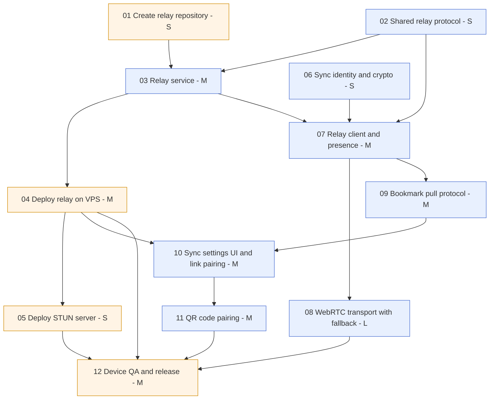

# Epic 0004: Bookmark device sync

**Status:** Planned
**Created:** 2026-10-31

## Summary

Users can copy bookmarks between their devices with no account. Every installation either generates a random sync secret (UUIDv4) or takes one from another device, either as a link sent through a messaging app or as a QR code. Devices with the same secret see each other while both have the Synchronisierung section open. On any listed device, the user can press "Lesezeichen abrufen" to pull every bookmark this device doesn't have yet. Everything is end-to-end encrypted with a key derived from the secret. Devices connect directly via WebRTC when possible, using a self-hosted STUN server. Otherwise a small relay service forwards the encrypted messages. The relay keeps everything in memory and never writes anything to disk.

## Goals

- A user can create a sync secret, share it as a link and as a QR code, and join an existing secret by link, by QR scan or by typing it in.
- Devices with the same secret see each other in an "online devices" list (name + transport), and only those devices, while both have the Synchronisierung section open.
- Pressing "Lesezeichen abrufen" next to an online device adds every bookmark missing locally, and marks local bookmarks as viewed if the source has them viewed. The user sees a result such as "12 hinzugefügt, 3 als gelesen markiert".
- All sync payloads, including WebRTC signaling and device names, are encrypted with AES-GCM in the browser. The relay only sees a room ID derived from the secret, peer IDs, ciphertext, IP addresses and timing.
- Devices connect directly over a WebRTC data channel where possible. If that fails within a timeout, they fall back to the relay with no user action needed.
- Relay (`wss://relay.orfarchiv.news/ws`) and STUN (`stun:relay.orfarchiv.news:3478`) both run on the existing VPS, with no database, no disk writes and no logging of IDs or IP addresses.
- Production, `develop` and Vercel preview deployments can all use the relay.
- The Docker/`adapter-node` image can enable sync with the build args `PUBLIC_SYNC_RELAY_URL` and `PUBLIC_SYNC_STUN_URL`. Without them, the section is hidden.

## Non-goals

- Automatic or background sync, and presence outside the Synchronisierung section. Sync only happens when the user presses the button.
- Syncing deletions (no tombstones). **Known limitation:** a bookmark deleted locally comes back when it is pulled from a device that still has it. Accepted for v1.
- Setting a bookmark back to "not viewed" through sync. Viewed status only ever goes from not viewed to viewed.
- Syncing settings, AI keys, sources or anything other than bookmarks.
- Removing a single device from a group. The only way out is a new secret (see Risks).
- A TURN server or any third-party STUN server. The relay is the fallback when no direct connection is possible.
- Offline queuing. Both devices must have the section open at the same time.

## Background & context

- **Bookmarks** are stored only on the device, in IndexedDB through Dexie. The database is `BOOKMARKS_STORE_NAME = 'bookmarks'` ([ui/src/lib/configs/client.ts](../../../ui/src/lib/configs/client.ts)) and the table is `stories` (`id, timestamp, isBookmarked, isViewed`) ([ui/src/lib/stores/persistence/bookmarksDb.ts](../../../ui/src/lib/stores/persistence/bookmarksDb.ts)). Rows are full `Story` objects ([ui/src/lib/models/story.ts](../../../ui/src/lib/models/story.ts)) whose flags are numbers (`0`/`1`). The store ([ui/src/lib/stores/bookmarks.ts](../../../ui/src/lib/stores/bookmarks.ts)) reads through `liveQuery`, so rows written to Dexie show up in the UI right away. Deletes remove rows, and no record of the deletion is kept.
- **Settings** are a `svelte-persisted-store` in localStorage ([ui/src/lib/stores/settings.ts](../../../ui/src/lib/stores/settings.ts)). The settings page ([ui/src/lib/components/settings/Settings.svelte](../../../ui/src/lib/components/settings/Settings.svelte)) is a two-column grid of `Section` / `SectionList` / `Item` components. The UI text is German.
- **Hosting:** the UI runs on Vercel (`adapter-vercel`), which can't keep WebSocket connections open. A Docker/`adapter-node` build also exists ([ui/Dockerfile](../../../ui/Dockerfile)). It bakes public env variables in with `ENV` at build time, uses the same `kit.csp` from `csp-config.js`, and sends no `Permissions-Policy` header, because that header only comes from `vercel.json`. The VPS (epic [0001](../0001-self-hosted-db/README.md), story 07) already runs Docker Compose, host nginx, certbot and an iptables firewall, and hosts other containers whose images come from ghcr.io.
- **Security headers:** the CSP is in [ui/csp-config.js](../../../ui/csp-config.js) (`connect-src 'self' https://generativelanguage.googleapis.com`). `Permissions-Policy` in [ui/vercel.json](../../../ui/vercel.json) sets `camera=()`, which blocks QR scanning, and allows `web-share=(self)` and `clipboard-write=(self)`.
- **Shared code** lives in `orfarchiv-shared` and is mounted in `ui` at `src/lib/shared/common` (`#common/*`). It uses one folder per feature (`shared/src/<feature>/<feature>.ts` plus `<feature>.constants.ts`).

## Proposed approach

### Keys and identity

```text
secret (UUIDv4, stays on device, shared only via link/QR)
  ├─ HKDF-SHA256(info="orfarchiv-sync/room/v1") → roomId  (32 bytes, hex) → sent to relay
  └─ HKDF-SHA256(info="orfarchiv-sync/key/v1")  → AES-GCM-256 key   → never leaves the device
```

- All crypto uses the browser's WebCrypto API (`crypto.subtle`), with no extra library.
- `peerId` is a random ID per connection, not tied to the device. The device name is user-editable and defaults to a value derived from the user agent (e.g. "Android · Chrome"). It is only ever sent encrypted.
- A message counts as authentic if it decrypts under the group key **with the additional data `orfarchiv-sync/v1|<roomId>|<fromPeerId>|<toPeerId>`**. The sender knows both peer IDs, and the receiver takes `from` from the relay envelope and uses its own `peerId`. If the relay redirects or relabels a message, decryption fails. Because `peerId`s are new for each connection, a replay only works within the same connection pair, and random, single-use `requestId`s (story 09) reject stale responses. Messages that fail to decrypt are dropped silently.

### Pairing

- Link: `${origin}/settings#sync=<secret>`. The part after `#` is never sent to any server. Opening the link asks before joining or replacing the current secret, then removes the fragment from the URL.
- QR code: the same link, rendered with `uqr` in the sync section. It can be scanned with the phone's camera app, or with the in-app scanner, which uses native `BarcodeDetector` with `jsqr` as fallback. The in-app scanner matters on iOS, where an installed PWA has its own storage, separate from Safari's.
- Manual: paste or type the UUID.
- Sharing uses the system share menu (`navigator.share`), falling back to copying to the clipboard.

### Transport: relay first, then upgrade to WebRTC

```text
 Device A ──wss──▶ relay.orfarchiv.news (room = roomId) ◀──wss── Device B
     │      presence + encrypted signaling + fallback data       │
     │                stun:relay.orfarchiv.news:3478             │
     └──────────────── WebRTC DataChannel (preferred) ───────────┘
```

1. A device connects to the relay **only while the Synchronisierung section is open**, sync is configured and the page is visible. It joins `roomId` and disconnects on leaving the section, hiding the page or turning sync off. The rest of the app opens no sync connections.
2. The relay sends the list of peer IDs in the room. Peers exchange encrypted `hello` messages carrying their device names.
3. For each peer, the device with the smaller `peerId` starts a WebRTC connection. The offer, answer and ICE candidates are sent as encrypted messages through the relay, so the relay can't read SDP or local IP addresses. ICE uses only the self-hosted STUN server.
4. If the data channel isn't open within 5 s, or it fails later, messages to that peer go through the relay. The online devices list shows which transport is in use ("Direkt" / "Relay").
5. Both transports carry the same framed, encrypted, chunked messages. Code above the transport layer can't tell which one is in use.

### Sync protocol (pull)

1. A sends `sync-request` to B.
2. B reads its Dexie `stories` table and sends `sync-response` in chunks (≤ 16 KiB of plaintext per chunk, ending with `final`). B shows a short notification: "‹A› hat deine Lesezeichen abgerufen".
3. A decodes each `Story` with the Effect `Story` schema (invalid entries are skipped and counted). For each story:
   - unknown `id` → `add` with `isBookmarked: 1` and the source's `isViewed`;
   - known `id`, source `isViewed === 1`, local not viewed → set `isViewed: 1`;
   - otherwise → leave unchanged.
4. A shows the counts. With nothing new, it shows "Bereits aktuell".

### Relay (new repo `orfarchiv-relay`, submodule `relay`)

A Node WebSocket server (`ws`). In memory it keeps `Map<roomId, Map<peerId, socket>>`. It handles `join`, broadcasts `peers`, and forwards `{to, payload}` within the same room only. Limits: message size 64 KiB, peers per room 16, a per-connection rate limit, idle ping/timeout, and a total connection cap. An origin allow-list with wildcard support covers `orfarchiv.news`, `develop.orfarchiv.news` and `orfarchiv-*-robins-projects-bb10f956.vercel.app` previews. It has a `/health` endpoint, logs counts only, and is published as a Docker image to ghcr.io. The repo is set up like `scraper`. The wire envelope schema and limits live in `orfarchiv-shared` so that `ui` and the relay agree on them.

### STUN

coturn in `--stun-only` mode on the VPS (`network_mode: host`, UDP 3478, logging off). If `PUBLIC_SYNC_STUN_URL` is unset, the UI uses no ICE servers: direct connections then only work on the same network, and everything else uses the relay. The UI never falls back to a public STUN server.

### Alternatives considered

| Option                                   | Why not                                                                                                                                            |
| ---------------------------------------- | -------------------------------------------------------------------------------------------------------------------------------------------------- |
| Relay only                               | Simpler, but every byte goes through our server. The user chose the hybrid approach.                                                               |
| Public STUN (Cloudflare/Google)          | Shows user IP addresses to a third party. Self-hosting it is one container.                                                                        |
| Hosted realtime service (Ably/Pusher)    | Adds a third-party account and data processor, against the "server stores nothing" goal.                                                           |
| Relay inside the `ui` app                | Vercel can't keep WebSocket connections open, and Docker is only the backup deploy path.                                                           |
| Always-on presence while the app is open | Lets you pull without opening the section on the source device, but keeps a socket open for every sync user. The user chose section-only presence. |
| Merge with tombstones / last-write-wins  | Not needed for manual, additive pulls. Rejected to keep v1 simple.                                                                                 |

## Stories

| #   | Story                                                       | Owner  | Size | Depends on     | Status |
| --- | ----------------------------------------------------------- | ------ | ---- | -------------- | ------ |
| 01  | [Create relay repository](01-create-relay-repo.md)          | Human  | S    | –              | Todo   |
| 02  | [Shared relay protocol](02-shared-relay-protocol.md)        | Claude | S    | –              | Todo   |
| 03  | [Relay service](03-relay-service.md)                        | Claude | M    | 01, 02         | Todo   |
| 04  | [Deploy relay on VPS](04-deploy-relay.md)                   | Human  | M    | 03             | Todo   |
| 05  | [Deploy STUN server](05-deploy-stun-server.md)              | Human  | S    | 04             | Todo   |
| 06  | [Sync identity and crypto](06-sync-identity-crypto.md)      | Claude | S    | –              | Todo   |
| 07  | [Relay client and presence](07-relay-client-presence.md)    | Claude | M    | 02, 03, 06     | Todo   |
| 08  | [WebRTC transport with fallback](08-webrtc-transport.md)    | Claude | L    | 07             | Todo   |
| 09  | [Bookmark pull protocol](09-bookmark-pull-protocol.md)      | Claude | M    | 07             | Todo   |
| 10  | [Sync settings UI and link pairing](10-sync-settings-ui.md) | Claude | M    | 04, 09         | Todo   |
| 11  | [QR code pairing](11-qr-code-pairing.md)                    | Claude | M    | 10             | Todo   |
| 12  | [Device QA and release](12-device-qa-release.md)            | Human  | M    | 04, 05, 08, 11 | Todo   |

**Size overview:** 4×S, 7×M, 1×L. Claude: 2×S, 5×M, 1×L (8 stories). Human: 2×S, 2×M (4 stories). The largest risk is story 08 (L): WebRTC behaviour differs between browsers and NAT setups, the timing of the fallback is tricky, and it's hard to test without real devices. It stays one story because offer/answer, ICE and fallback only make sense together, and story 09 doesn't depend on it, so the feature works over the relay alone.

## Story order



Stories 01, 02 and 06 can start right away and in parallel. Stories 08 and 09 can run in parallel after 07. The relay deployment (04) must be done before 10, so its e2e tests run against a live relay. The STUN deployment (05) can happen at any point before 12.

## Risks & open questions

- **Both devices must have the section open.** This was a deliberate choice for privacy and less traffic, but users may expect the other device to just be found. The empty state and a permanent hint (story 10) explain it, and story 12 checks it on real devices.
- **iOS PWA storage.** An installed PWA on iOS has storage separate from Safari. Opening a pairing link from Messages opens Safari, not the PWA. The in-app QR scanner (story 11) and pasting the secret by hand are the workarounds, and the UI explains this.
- **Direct connections across networks.** With STUN only and no TURN, carrier-grade or symmetric NAT often prevents a direct connection, and the relay takes over. Story 12 records how often this happens. TURN on the same coturn instance would be a possible follow-up.
- **No way to remove a single device.** Anyone with the secret can pull bookmarks. The only way to remove someone is for every remaining device to switch to a new secret. Mitigations: the source device shows a notification when its bookmarks are pulled, and the UI makes it easy to generate a new secret.
- **Relay abuse.** It's a public WebSocket endpoint. Mitigations: an origin allow-list, size, rate and connection limits (story 03) plus `limit_conn` in nginx (story 04). Rooms are not authenticated, so anyone who guesses a room ID only sees ciphertext and peer counts. Room IDs are 256-bit, so guessing one isn't realistic. The `Origin` header can be faked by non-browser clients, so the allow-list only stops other websites, not scripts.
- **The preview origin pattern depends on the Vercel team slug** (`robins-projects-bb10f956`). If the slug changes, previews get 403 until `RELAY_ALLOWED_ORIGINS` is updated.
- **`jsqr` is unmaintained** but stable. If scanning is unreliable on real devices (story 12), switch to the `barcode-detector` polyfill (WASM, needs CSP and self-hosting work).
- **Your VPS work is on the UI's critical path.** Story 10 can't merge until story 04 (relay deployment) is done.
- **UI e2e runs depend on the VPS.** Sync specs use the production relay, so a relay outage makes them fail on every UI deployment, even for changes unrelated to sync. The 2 CI retries absorb short outages.
- **Metadata.** The relay and STUN server see IP addresses and timing. The sync section states this in one sentence. Neither service logs them.

## Assumptions

- Pairing links use `location.origin`, so preview and develop deployments produce working links for their own origin.
- `PUBLIC_SYNC_RELAY_URL` (`wss://relay.orfarchiv.news/ws`) and `PUBLIC_SYNC_STUN_URL` (`stun:relay.orfarchiv.news:3478`) are declared in [ui/src/env.ts](../../../ui/src/env.ts) as `static: true, public: true`, optional, so the CSP built at build time and the client always agree. If the relay URL is unset, the sync section is hidden.
- The relay lives in the new GitHub repo `Robin-w151/orfarchiv-relay`, added as a submodule `relay` of the superproject, with `orfarchiv-shared` mounted at `src/shared/common` like in `scraper`. The image is `ghcr.io/robin-w151/orfarchiv-relay`.
- E2E tests run in CI against the Vercel deployment ([ui/.github/workflows/test.yaml](../../../ui/.github/workflows/test.yaml)), so sync specs use the production relay through the preview origin. Each test generates its own secret, because tests run in parallel and share the relay with real users. Specs skip themselves while the sync section is hidden (relay URL unset). Story 10 sets `TEST_SYNC_REQUIRED: 'true'` in `test.yaml`, which makes them fail instead of skip. Story 10 depends on story 04, so the relay is live by then.
- Locally, the relay runs on port **3004**, the next free port after the UI (3001), mongo-express (3002) and the embedding server (3003): `docker run -p 3004:8080 -e RELAY_ALLOWED_ORIGINS=http://localhost:3001 ghcr.io/robin-w151/orfarchiv-relay` or `PORT=3004 npm start` in `relay/`, with `PUBLIC_SYNC_RELAY_URL=ws://localhost:3004/ws` in the UI's `.env.local`. Sync specs are run locally with `npm run test:e2e` against that setup.
- E2E coverage for sync lives in stories 10 and 11. Stories 07–09 have no UI that a deployed build could test, so they use unit tests plus a local manual check with two tabs and the local relay.
- The Docker image doesn't run anywhere yet, so no origin is added to `RELAY_ALLOWED_ORIGINS` now. Whoever deploys it later adds the origin to the relay's compose entry (story 04), or runs their own relay.
- Bookmark counts stay in the low thousands (≈ 300 B per story), so sending the full list per pull is fine.
- UI text is German, like the rest of the app.
- New dependencies: `ws` (relay); `uqr`, `jsqr` and the dev dependency `fake-indexeddb` (ui). All pinned to exact versions that are at least 48 h old.
- Branch `feat/bookmark-device-sync` in `ui`, `shared` and `relay`.

## Definition of done

- All stories are Done. `lint`, `check`, `test:unit` and `test:e2e` pass in `ui`, and lint/test pass in `shared` and `relay`. CI is green in all three repos.
- The relay and STUN server run in production on the VPS. `PUBLIC_SYNC_RELAY_URL` and `PUBLIC_SYNC_STUN_URL` are set on Vercel.
- `TEST_SYNC_REQUIRED: 'true'` is set in `ui/.github/workflows/test.yaml`, and the sync specs run (not skip) against the production deployment.
- Manual QA in story 12 passes for phone↔phone and phone↔desktop, over both direct and relay transport.
- The feature is released to `develop` and then to production.
